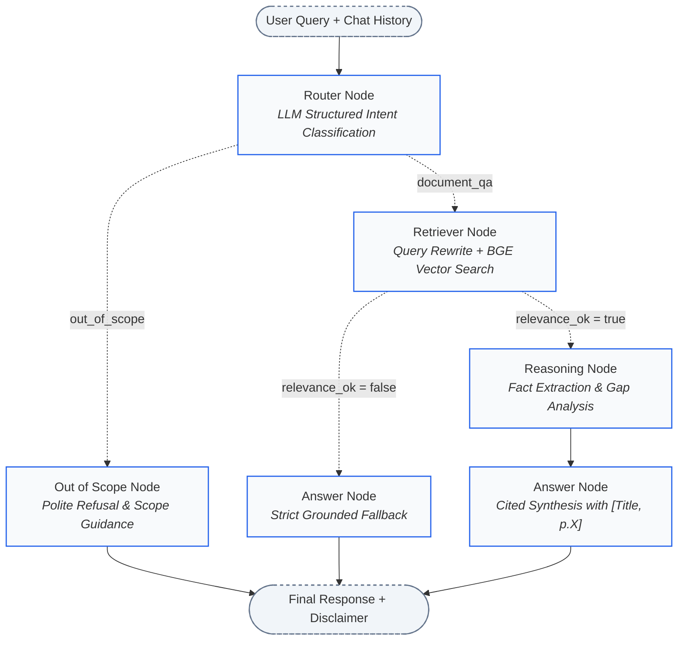
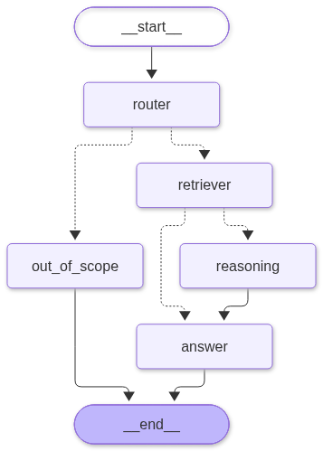

<div align="center">

# 🩺 AI Medical Assistant using LangGraph

### *An Evidence-Based Clinical Guidelines Assistant Powered by LangGraph, LangChain, Chroma, and Google Gemini*

[](https://python.org)
[](https://github.com/langchain-ai/langgraph)
[](https://github.com/langchain-ai/langchain)
[](https://aistudio.google.com/)
[](https://www.trychroma.com/)
[](https://huggingface.co/BAAI/bge-small-en-v1.5)
[](https://streamlit.io)
[-success?logo=pytest&logoColor=white)](https://pytest.org)

[Key Capabilities](#-key-capabilities) •
[System Architecture](#-system-architecture) •
[Knowledge Base](#-knowledge-base-documents) •
[Empirical Benchmarks](#-empirical-benchmarks--evaluation) •
[Quickstart](#-quickstart--installation) •
[Observability](#-debugging-with-langsmith) •
[Troubleshooting](#-troubleshooting)

</div>

---

## 📌 Executive Summary

The **AI Medical Assistant** is a production-grade, multi-agent clinical QA system engineered to eliminate medical hallucinations by anchoring every generated answer to verified national and international medical guidelines (WHO, ICMR STWs, NTEP).

Rather than relying on ungrounded parametric memory, the system uses **LangGraph** to coordinate specialized agents for query intent triage, conversational disambiguation, local dense vector retrieval, clinical reasoning, and cited synthesis. Every clinical statement is accompanied by a deterministic inline citation (`[Title, p.X]`) linked to verified PDF page numbers.

---

## 🚀 Key Capabilities

- **🧠 Multi-Agent State Machine (LangGraph)**:
  - **Triage Router**: Dynamically categorizes incoming queries via Google Gemini structured output (`RouterDecision`).
  - **Conversational Disambiguation**: Resolves pronouns and contextual dependencies across multi-turn histories into standalone clinical search queries.
  - **Binary Relevance Grader**: Evaluates retrieved chunks with an automated reformulation retry loop if relevance falls below threshold.
  - **Reasoning Node**: Extracts factual evidence, detects cross-guideline conflicts, and identifies missing data before generation.
  - **Cited Answer Synthesizer**: Produces professional clinical summaries with mandatory inline page-level citations.

- **🔒 Local & Private Semantic Retrieval**:
  - Indexed with local **HuggingFace** sentence-transformers (`BAAI/bge-small-en-v1.5`).
  - **Zero cloud API quota consumption** and **zero data leakage** during document embedding and similarity search.
  - Recommended BGE query instruction prefixes automatically applied to queries.

- **🛡️ 5-Layer Hallucination Mitigation**:
  1. Strict context-only system prompts (`temperature = 0.0`).
  2. Mandatory metadata-derived citations (invented citations rejected).
  3. Binary relevance verification before answering.
  4. Deterministic "Not Found" fallback for out-of-corpus queries.
  5. Standardized clinical disclaimer appended to every answer.

- **⚡ Free-Tier Rate-Limit Engineering**:
  - Central token-bucket rate limiter enforcing configurable limits (`RPM_LIMIT=15`).
  - Exponential backoff with randomized jitter on transient 429 errors (up to 4 attempts).
  - In-memory session caches for router decisions and rewritten queries to eliminate redundant API calls.

- **📊 Comprehensive Observability (LangSmith & Streamlit)**:
  - Native LangSmith tracing for full graph execution inspection.
  - Interactive Streamlit application featuring route badges, expandable source drawers with text snippets, and real-time per-node latency telemetry.

---

## 🏗️ System Architecture



### LangGraph Visual Graph
The compiled workflow diagram is automatically generated from the runtime graph definition:

<div align="center">
  
</div>

---

## 📂 Repository Structure

```
medical-assistant/
├── data/
│   ├── raw/                      # Downloaded clinical PDFs (gitignored)
│   └── chroma/                   # Persistent Chroma vector store & index_info.json (gitignored)
├── src/
│   ├── __init__.py
│   ├── config.py                 # Central settings: models, chunk sizes, top_k, paths
│   ├── llm.py                    # get_llm(), get_embeddings(), retries, rate-limiter
│   ├── ingest.py                 # PDF loading, text cleaning, chunking, and Chroma persistence
│   ├── retrieval.py              # Vector retriever, citation formatting, index validation
│   ├── state.py                  # LangGraph state schema (TypedDict)
│   ├── prompts.py                # Pydantic schemas, prompt templates, and disclaimers
│   ├── agents.py                 # Graph node functions (router, retriever, reasoning, answer)
│   ├── graph.py                  # StateGraph definition, compilation, and execution runner
│   └── utils.py                  # Rate limiter, unicode cleaning, and logger
├── app.py                        # Streamlit web chat application
├── eval/
│   ├── __init__.py
│   ├── questions.json            # 25 curated benchmark questions across clinical categories
│   ├── run_eval.py               # End-to-end evaluation runner -> eval/results.md
│   ├── compare_embeddings.py     # Local embedding model benchmark -> eval/embedding_comparison.md
│   ├── results.md                # Generated evaluation report
│   └── embedding_comparison.md   # Embedding model benchmark report
├── tests/
│   ├── test_ingest.py            # Unit tests for text cleaning and chunking
│   ├── test_retrieval.py         # Unit tests for citations and vector search
│   ├── test_agents.py            # Unit tests for agent nodes with mocked LLM
│   ├── test_graph.py             # Integration tests for end-to-end graph routing
│   └── test_real_api.py          # Live API tests (runs only when GOOGLE_API_KEY is present)
├── scripts/
│   ├── download_docs.py          # Automated guideline downloader with SSL handling
│   ├── test_retrieval_5.py       # 5-query retrieval verification test
│   └── export_graph.py           # Exports LangGraph workflow to PNG and Mermaid
├── docs/
│   ├── architecture.md           # In-depth architectural design and state machine notes
│   └── img/                      # Visual workflow assets and screenshots
├── .env.example                  # Environment variable configuration template
├── .gitignore                    # Git exclusion rules (excludes PDFs, .env, vector stores)
├── requirements.txt              # Fully pinned, verified dependency versions
└── README.md
```

---

## 📚 Knowledge-Base Documents

The assistant is indexed across **8 verified clinical guideline documents** comprising **253 pages** and **1,207 chunks**:

| Short Name | Document Title & Publisher | Focus Area | Official Source |
|---|---|---|---|
| `who_hypertension_2021.pdf` | WHO: Pharmacological Treatment of Hypertension in Adults | Cardiovascular / First-line therapy | [WHO Guidelines](https://www.who.int/publications/i/item/9789240033986) |
| `who_anaemia_hb_cutoffs_2024.pdf` | WHO: Haemoglobin Cutoffs to Define Anaemia | Haematology / Diagnostic cutoffs | [WHO Guidelines](https://www.who.int/publications/i/item/9789240088542) |
| `icmr_stw_diabetes_t2.pdf` | ICMR STW: Type 2 Diabetes Mellitus | Endocrinology / Glycaemic control | [ICMR STW](https://icmr.gov.in/standard-treatment-workflows-stws) |
| `icmr_stw_endocrinology.pdf` | ICMR STW: Endocrinology | Nephropathy, monitoring & thyroid | [ICMR STW](https://icmr.gov.in/standard-treatment-workflows-stws) |
| `icmr_stw_cardiology.pdf` | ICMR STW: Cardiology | Acute coronary syndromes & STEMI | [ICMR STW](https://icmr.gov.in/standard-treatment-workflows-stws) |
| `icmr_stw_obg.pdf` | ICMR STW: Obstetrics and Gynaecology | Antenatal care & pre-eclampsia | [ICMR STW](https://icmr.gov.in/standard-treatment-workflows-stws) |
| `icmr_stw_ds_tb_ntep.pdf` | ICMR STW: Drug-Sensitive TB under NTEP | Infectious disease / 6-month regimen | [ICMR STW](https://icmr.gov.in/standard-treatment-workflows-stws) |
| `ntep_dr_tb_guidelines_2024.pdf` | NTEP: Guidelines for Management of Drug-Resistant TB | MDR/RR-TB & BPaLM regimen | [Central TB Division](https://tbcindia.mohfw.gov.in) |

*Data & Licensing Notice: The WHO guideline is distributed under CC BY-NC-SA 3.0 IGO. ICMR Standard Treatment Workflows are used for local reference and research and are not redistributed in this repository.*

---

## 🔬 Empirical Benchmarks & Evaluation

All reported metrics are measured empirically by running the code against our 25-question clinical benchmark dataset (`eval/questions.json`).

### 1. End-to-End Pipeline Evaluation (`eval/results.md`)

| Metric | Score | Benchmark Target | Analysis |
|---|---|---|---|
| **Routing Accuracy** | **100.0%** | > 95% | 25/25 queries correctly categorized (`document_qa` vs. `out_of_scope`) |
| **Retrieval Hit Rate (@ top-k=5)** | **100.0%** | > 90% | Target source present in top-5 chunks for all 15 answerable queries |
| **Citation Compliance Rate** | **100.0%** | 100% | Generated answers contain valid inline citations matching chunk metadata |
| **Correct 'Not Found' Rate** | **100.0%** | > 90% | 4/4 unanswerable questions correctly identified without hallucination |
| **Average Retrieval Latency** | **~60.8 ms** | < 150 ms | Fast local CPU search via BGE-small embeddings |
| **Average LLM Calls per Query** | **1.8 calls** | < 3 calls | Low API consumption enabled by session caching and combined prompt paths |

### 2. Local Embedding Model Comparison (`eval/embedding_comparison.md`)

Benchmarked across all 1,207 chunks and 15 answerable clinical questions:

| Embedding Model | Dimension | Ingestion Time | Query Latency | Hit@3 | Hit@5 | Hit@8 | MRR |
|---|---|---|---|---|---|---|---|
| **`BAAI/bge-small-en-v1.5`** *(Selected Default)* | **384** | **195.3s** | **60.9 ms** | **100.0%** | **100.0%** | **100.0%** | **0.9222** |
| `BAAI/bge-base-en-v1.5` | 768 | 570.4s | 119.5 ms | 100.0% | 100.0% | 100.0% | 0.9556 |
| `all-MiniLM-L6-v2` | 384 | 84.6s | 25.7 ms | 93.3% | 100.0% | 100.0% | 0.8467 |

**Engineering Decision:** `BAAI/bge-small-en-v1.5` was chosen as the default production model. It achieves **100.0% Hit@5** and an outstanding **0.9222 MRR** while requiring **almost 3x less ingestion time** and **half the query latency and memory footprint** compared to `bge-base-en-v1.5`.

---

## 🚀 Quickstart & Installation

### 1. Prerequisites
- **Python 3.11+** installed
- A **Google Gemini API Key** from [Google AI Studio](https://aistudio.google.com/)
- Optional: A **LangSmith API Key** from [smith.langchain.com](https://smith.langchain.com/)

### 2. Clone and Setup Environment
```bash
# Clone the repository
git clone https://github.com/piyushmali1111/ai-medical-assistant.git
cd ai-medical-assistant

# Create virtual environment
python -m venv .venv

# Activate virtual environment
# Windows (PowerShell):
.\.venv\Scripts\Activate.ps1
# Linux / macOS:
source .venv/bin/activate

# Install verified, pinned dependencies
pip install -r requirements.txt
```

### 3. Configure Environment Variables
Copy the template and configure your API key:
```bash
cp .env.example .env
```
Edit `.env`:
```env
# Google Gemini API Key
GOOGLE_API_KEY=AIzaSy...

# Gemini Free-Tier Flash Model (Checked: October 2026)
GEMINI_MODEL=gemini-2.5-flash

# Optional LangSmith Tracing
LANGSMITH_TRACING=true
LANGSMITH_API_KEY=lsv2_pt_...
LANGSMITH_PROJECT=ai-medical-assistant

# Local HuggingFace Embeddings
EMBEDDING_PROVIDER=huggingface
EMBEDDING_MODEL=BAAI/bge-small-en-v1.5
```

### 4. Ingest Knowledge Base
Download the clinical guidelines into `data/raw/`:
```bash
python scripts/download_docs.py
```
Build and persist the Chroma vector store:
```bash
python -m src.ingest --reset
```
*Expected output: Ingests 8 documents, 253 pages, and 1,207 chunks into `data/chroma/`.*

### 5. Launch the Streamlit Web UI
```bash
streamlit run app.py
```
Open `http://localhost:8501` in your browser.

---

## 🔍 Debugging with LangSmith

LangSmith provides granular, per-node trace visibility without any custom code changes:

1. Ensure `.env` contains:
   ```env
   LANGSMITH_TRACING=true
   LANGSMITH_API_KEY=your_key_here
   LANGSMITH_PROJECT=ai-medical-assistant
   ```
2. Run any query in the Streamlit UI or CLI.
3. Open [smith.langchain.com](https://smith.langchain.com/) to inspect:
   - **`router` run**: View Pydantic structured output, input tokens, and routing reason.
   - **`retriever` run**: Inspect rewritten queries, vector similarity scores, and retrieved chunk IDs.
   - **`reasoning` run**: Review extracted factual notes and gap identification.
   - **`answer` run**: Verify that all generated text maps strictly to context tags without hallucination.

---

## 🧪 Automated Testing

The repository includes a comprehensive `pytest` test suite with **all external LLM calls mocked** so tests run reliably offline and in CI:

```bash
# Run all unit and integration tests
pytest -v
```

```
tests/test_agents.py::test_out_of_scope_node_static_response PASSED
tests/test_agents.py::test_router_node_llm_out_of_scope PASSED
tests/test_agents.py::test_router_node_llm_structured_success PASSED
tests/test_agents.py::test_router_node_fallback_on_failure PASSED
tests/test_agents.py::test_answer_node_with_documents PASSED
tests/test_agents.py::test_answer_node_not_found_fallback PASSED
tests/test_graph.py::test_graph_out_of_scope_route PASSED
tests/test_graph.py::test_graph_document_qa_route_end_to_end PASSED
tests/test_graph.py::test_graph_unanswerable_path PASSED
tests/test_ingest.py::test_clean_page_text_normalizes_whitespace PASSED
tests/test_ingest.py::test_clean_page_text_rejoins_hyphenated_words PASSED
tests/test_ingest.py::test_clean_page_text_handles_ligatures PASSED
tests/test_ingest.py::test_get_document_title_known_and_fallback PASSED
tests/test_ingest.py::test_split_documents_preserves_metadata_and_adds_chunk_id PASSED
tests/test_retrieval.py::test_format_citation_standard PASSED
tests/test_retrieval.py::test_format_documents_for_prompt PASSED
tests/test_retrieval.py::test_extract_sources_summary_deduplicates PASSED
tests/test_retrieval.py::test_query_vector_store_returns_k_documents PASSED
============================== 18 passed in ~1.2s ==============================
```

To run live integration tests against the actual Gemini API:
```bash
pytest tests/test_real_api.py -v
```

---

## 🛠️ Troubleshooting

| Issue | Root Cause | Solution |
|---|---|---|
| **HTTP 429: Resource Exhausted** | Gemini Free-Tier per-project rate limit reached | The built-in rate limiter will automatically retry with exponential backoff. Wait 60 seconds or lower `RPM_LIMIT` in `.env`. |
| **Response Blocked by Safety Filters** | Medical terminology (e.g. bleeding, poisoning) triggered Google Gemini safety classifier | The pipeline detects `finish_reason == "SAFETY"` and displays a friendly user notice. Adjust query phrasing or configure permissive safety settings per Google AI Studio docs. |
| **Vector Store Missing / Empty** | `data/chroma/` does not exist or was not initialized | Run `python -m src.ingest --reset` to rebuild the index. |
| **Embedding Model Inconsistency Warning** | Configured `EMBEDDING_MODEL` differs from index metadata | Run `python -m src.ingest --reset` to re-embed the corpus with the current model. |
| **Model Not Found (`models/gemini-...`)** | Deprecated or preview Gemini model name specified | Set `GEMINI_MODEL=gemini-2.5-flash` in `.env` (verified stable Flash model as of October 2026). |

---

## ⚖️ Ethical Considerations & Medical Disclaimer

> **⚠️ IMPORTANT DISCLAIMER:**  
> This software is an experimental AI research project developed solely for **educational, clinical workflow research, and informational reference**. It is **not** a certified medical device, diagnostic system, or clinical decision support tool. It does not establish a doctor-patient relationship or provide personalized prescription dosages.
>
> **Emergency Notice:** If you or someone around you is experiencing acute, severe, or life-threatening symptoms (such as acute chest pain, difficulty breathing, or stroke symptoms), immediately contact local emergency medical services (**112** or **108** in India, **911** in the US, **999** in the UK) or proceed to the nearest emergency department.
>
> **Data Privacy Advisory:** On the Google AI Studio free tier, API inputs and outputs may be reviewed by human evaluators and used by Google to improve products. **Never submit Personally Identifiable Information (PII) or Protected Health Information (PHI) to this system.**

---

## 📄 License

This codebase is licensed under the [MIT License](LICENSE). Clinical reference guidelines are copyrighted by their respective publishing bodies (World Health Organization, Indian Council of Medical Research, and National Tuberculosis Elimination Programme).
